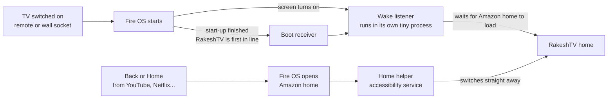
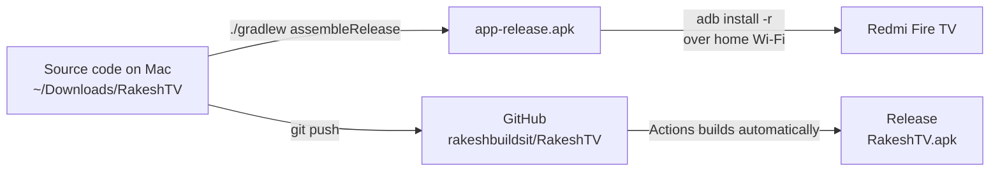

# RakeshTV 📺

**A clean, fast, ad-free home screen for the Redmi Fire TV.**

RakeshTV replaces Amazon's busy, ad-filled home with a simple screen: your favourite apps, all your apps, the clock, and quick buttons for Wi-Fi, Bluetooth and inputs. It opens by itself when the TV turns on, and you return to it when you leave any app.

Built for the **Redmi Fire TV 32" (TTE_L32R8-FVIN), Fire OS 7.7**. It also works on Android TV and Google TV.

---

## The home screen

```
┌──────────────────────────────────────────────────────────────────┐
│ Redmi Fire TV                                    12:41:07 PM     │
│ Good afternoon                          Sunday, 1 November 2026  │
│ [⇄ Inputs]                         [Wi-Fi ✓] [Bluetooth] [ ⚙ ]   │
│                                                                  │
│ Favourites                                                       │
│ [YouTube] [Prime Video] [Netflix] [Hotstar] [aha] [Appstore]     │
│                                                                  │
│ All apps · 15                                                    │
│ [ ] [ ] [ ] [ ] [ ] [ ] [ ]                                      │
│ [ ] [ ] [ ] [ ] [ ] [ ] [ ]                                      │
└──────────────────────────────────────────────────────────────────┘
```

- **Top left:** TV name, greeting, and **Inputs** (HDMI / AV)
- **Top right:** clock with seconds, date, **Wi-Fi** status, **Bluetooth**, and **⚙** settings
- **Favourites:** YouTube, Prime Video, Netflix, Hotstar, aha and Appstore (found automatically if installed)
- **All apps:** 7 per row (changeable to 5–8), with no ads or sponsored rows
- **Remote-friendly:** tiles zoom and glow as you move. Hold **OK** or press **☰ Menu** on any app to add it to favourites, move it left or right, hide it, open app info or uninstall it
- **7 wallpaper themes** and **6 highlight colours**
- **Lightweight:** plain Android with no extra libraries, so it suits the TV's small memory

---

## How RakeshTV takes over the TV

Fire OS doesn't let apps become the real home screen, so RakeshTV uses two small helpers that bring it to the front at the right moments.



| Situation | How fast RakeshTV appears |
|---|---|
| TV on with the **remote** (from standby) | about 1–2 s |
| TV on at the **wall socket** (full start-up) | about 4 s after the Amazon home appears |
| **Back** out of an app | under 1 s |
| **Home** button | 0.5–4 s, because Android holds back non-system apps for up to 5 s after a Home press. Fire OS doesn't let apps capture the Home button itself |

**What each piece does**
- **Boot receiver** (`BootReceiver.java`): notices the TV has finished starting up. It has top priority, so it runs before other apps.
- **Wake listener** (`WakeService.java`): notices when the screen turns on from standby and opens RakeshTV. It runs in a separate small process, so the home screen's memory can be freed while you watch something.
- **Home helper** (`HomeOverrideService.java`): an accessibility service that only checks *which app* just opened. When it's the Amazon home, it switches to RakeshTV. It reads nothing else on screen.

Both can be turned off in **⚙ settings**: *Open RakeshTV when TV turns on* and *Replace Fire TV home*.

---

## How the app gets onto the TV



- **Everyday route:** build on the Mac and install over Wi-Fi with ADB.
- **Backup route:** every `git push` makes GitHub build a fresh **RakeshTV.apk** under **Releases**, with nothing to install. The repo is private, so you need to be signed in to download it.

---

## Setup (one time)

### 1. Prepare the Fire TV
1. **Settings → My Fire TV → About** → highlight the TV name → press **OK 7 times** to unlock **Developer options**.
2. **Settings → My Fire TV → Developer options → ADB debugging → ON**.
3. Note the TV's IP address under **Settings → My Fire TV → About → Network**.

### 2. Prepare the Mac
```bash
brew install openjdk@17
brew install --cask android-commandlinetools android-platform-tools
export JAVA_HOME="/opt/homebrew/opt/openjdk@17/libexec/openjdk.jdk/Contents/Home"
export ANDROID_HOME="/opt/homebrew/share/android-commandlinetools"
yes | sdkmanager --licenses
sdkmanager "platforms;android-34" "build-tools;34.0.0"
```

### 3. Build and install
```bash
cd ~/Downloads/RakeshTV
./gradlew assembleRelease
adb connect <TV-IP>:5555
adb install -r app/build/outputs/apk/release/app-release.apk
```
The first time, accept **"Allow USB debugging?"** on the TV and tick **Always allow**.

### 4. Turn on the Home helper
```bash
adb shell settings put secure enabled_accessibility_services com.lumen.tvlauncher/com.lumen.tvlauncher.HomeOverrideService
adb shell settings put secure accessibility_enabled 1
```

### 5. Open RakeshTV once on the TV
This starts the wake listener. From now on it opens by itself.

---

## Updating

```bash
cd ~/Downloads/RakeshTV
git pull                      # if you changed anything on GitHub
./gradlew assembleRelease
adb connect <TV-IP>:5555
adb install -r app/build/outputs/apk/release/app-release.apk
git add . && git commit -m "what changed" && git push
```
Then **open RakeshTV once** on the TV. Updating restarts the app, and your favourites and settings are kept. If the Home helper stops working after an update, run step 4 again.

---

## Going back to the normal Fire TV

- **Temporarily:** ⚙ → *Replace Fire TV home* → **Off**, and ⚙ → *Open RakeshTV when TV turns on* → **Off**
- **Completely:** `adb uninstall com.lumen.tvlauncher`, or **Settings → Applications → Manage Installed Applications → RakeshTV → Uninstall**

Amazon's home screen is never changed or removed, so it comes straight back.

> Don't follow online tricks that *disable* Amazon's launcher with ADB. On Fire TV that can leave you with no home screen at all.

---

## Project structure

```
RakeshTV/
├── app/src/main/
│   ├── AndroidManifest.xml              App, boot receiver, wake listener, Home helper
│   ├── java/com/lumen/tvlauncher/
│   │   ├── MainActivity.java            The home screen: header, favourites, app grid, ⚙ menu
│   │   ├── AppEntry.java                Finds installed apps, icons and TV banners
│   │   ├── Prefs.java                   Saved settings (favourites, theme, apps per row…)
│   │   ├── Themes.java                  Wallpaper gradients and highlight colours
│   │   ├── BootReceiver.java            Runs when the TV finishes starting up
│   │   ├── WakeService.java             Opens RakeshTV when the screen turns on
│   │   └── HomeOverrideService.java     Switches from Amazon home to RakeshTV
│   └── res/
│       ├── drawable-xhdpi/banner.png    "RakeshTV" banner shown in the Fire TV app list
│       ├── drawable-xxxhdpi/ic_launcher.png
│       └── xml/home_override_service.xml
├── .github/workflows/build-apk.yml      Automatic cloud build
└── build.gradle, settings.gradle, gradlew
```

## Customising

- **Default favourites:** `DEFAULT_FAVORITES` at the top of `MainActivity.java`
- **Wallpapers and colours:** `Themes.java`
- **Tile sizes:** `makeTile()` and `build()` in `MainActivity.java` (favourites are 112×63, gaps 10)
- **Apps per row default:** `getColumns()` in `Prefs.java`
- **Power-on delay:** `openRakeshTVAfter(…)` in `WakeService.java`

---

Made by [@rakeshbuildsit](https://github.com/rakeshbuildsit)
